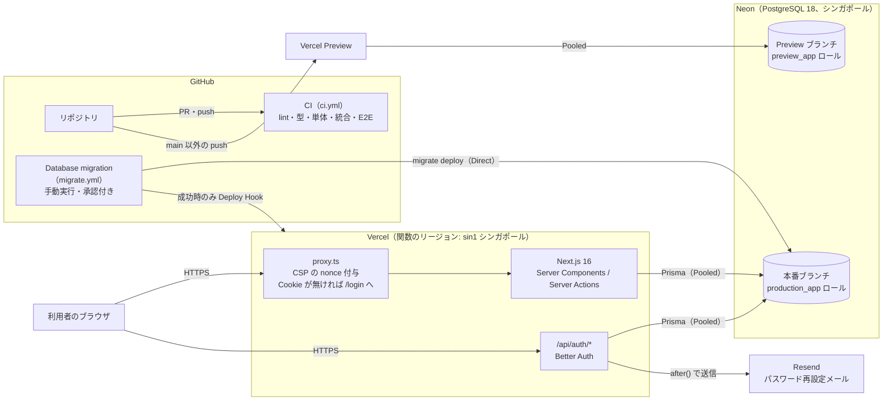
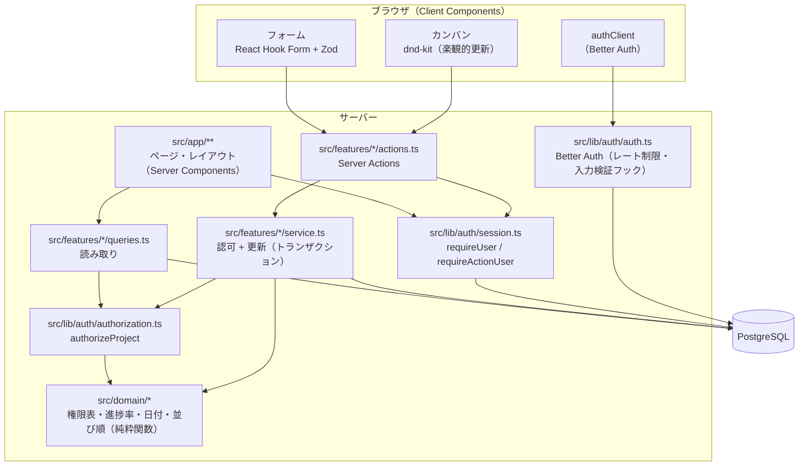
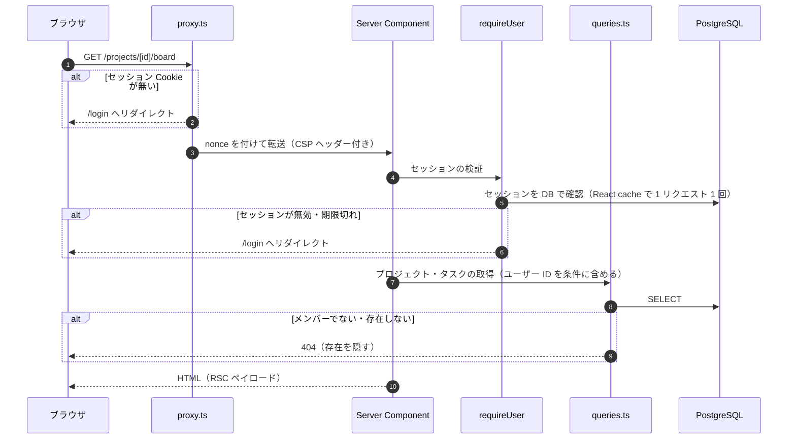
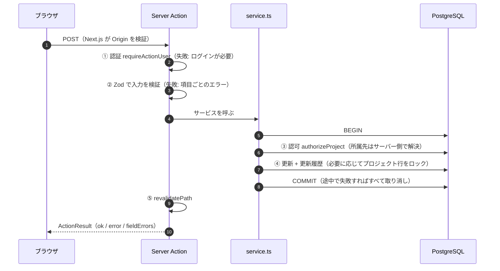
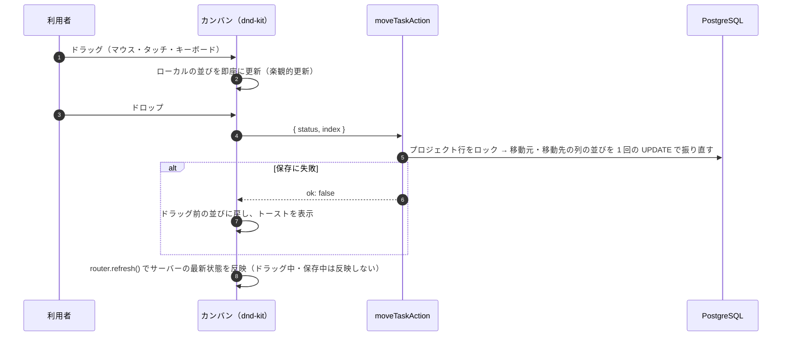
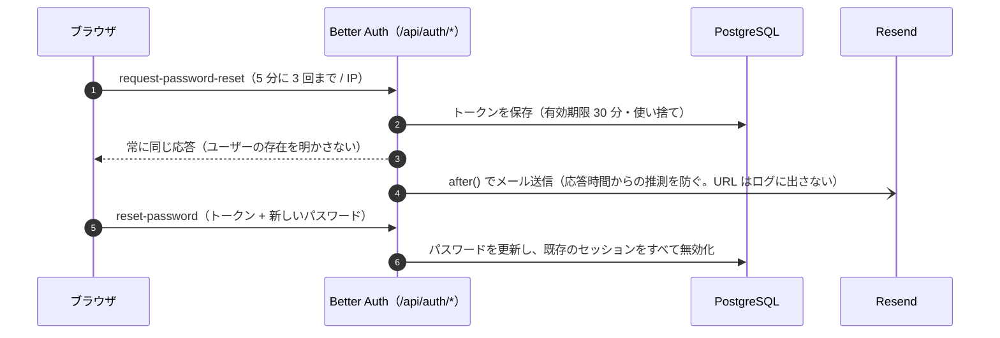
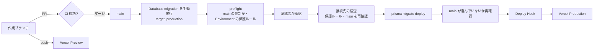

# アーキテクチャ図

> アプリ内部のレイヤーと責務は [design.md](./design.md) の 3 章、本番環境の設定手順は [deployment.md](./deployment.md)、更新処理の一覧は [server-actions.md](./server-actions.md) を参照。

## 1. システム構成（本番）

- 本番 URL: `https://projectflow.art-full-stack.com`（本番の `*.vercel.app` の URL ではログインできない。deployment.md 5.1）
- 関数と DB を同じシンガポールに置き、クエリごとの往復時間を小さくしている（`vercel.json` の `regions`）
- アプリは Pooled Connection・アプリ用ロール（テーブルの読み書きのみ）、マイグレーションは Direct Connection・`neondb_owner` を使う
- Production / Preview は、起動時（`instrumentation.ts`）と DB 接続時（`src/lib/db.ts`）に、接続先のブランチが環境と一致するかを検査する
- main への push では本番に自動デプロイしない（`vercel.json`）。本番デプロイはマイグレーションのワークフロー経由のみ

## 2. 環境

| 環境 | 実行場所 | DB | メール |
|---|---|---|---|
| Production | Vercel（sin1） | Neon 本番ブランチ | Resend（全ユーザー） |
| Preview | Vercel（sin1） | Neon Preview ブランチ | Resend（許可リストの宛先のみ） |
| ローカル | `npm run dev`（Node.js 24） | Docker の PostgreSQL 18（ポート 5433） | 送信せずコンソールに URL を出力 |
| CI | GitHub Actions | サービスコンテナの PostgreSQL 18 | 送信しない |

## 3. アプリ内部の構成

- 読み取りは Server Components からクエリを直接呼ぶ。更新は Server Actions だけが入口（REST API は作らない）
- 認証（ユーザー登録・ログイン・パスワード関連・プロフィール更新）は Better Auth の API（`/api/auth/*`）をブラウザから呼ぶ
- `src/domain` はフレームワーク・DB に依存しない純粋関数で、単体テストの主な対象

## 4. 主な処理の流れ

### 4.1 画面の表示（読み取り）

`proxy.ts` は Cookie の有無だけを見る楽観的なチェックで、正当性の検証は必ずサーバー側（`requireUser`）で行う。

### 4.2 更新（Server Action）

- 例外は `runAction` で `ActionResult` に変換する。予期しない例外は詳細をクライアントに返さず、サーバーのログにだけ残す
- 各 Action の内容は [server-actions.md](./server-actions.md)

### 4.3 カンバンのドラッグ＆ドロップ

### 4.4 パスワード再設定

## 5. リリースの流れ

どの段階でも失敗すれば以降は実行されない。詳細は deployment.md の 6・7 章。
