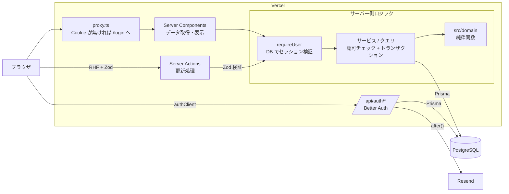

# ProjectFlow 設計書

> 初版: 2026-10-30 / 最終更新: 2026-10-31（Phase 4 完了時点）
> 対象: 要件定義書「プロジェクト管理アプリ 要件定義書」
> ステータス: **確定**（確認事項 Q1〜Q4 は 2026-10-30 に回答済み。「7. 決定事項」参照）

関連資料: [ER 図・テーブル設計](./er-diagram.md) / [進捗・フェーズ報告](./progress.md)

---

## 1. 要件分析サマリ

| 観点 | 内容 |
|---|---|
| 中心機能 | プロジェクト単位のカンバン（Todo / In Progress / Done）とドラッグ＆ドロップ |
| 利用規模 | 個人〜10人程度。1 プロジェクトあたりタスク数は数十〜数百件を想定 |
| 認可モデル | プロジェクト単位のメンバーシップ（Owner / Member）。所属外プロジェクトは一切参照不可 |
| データ量 | 小規模。リアルタイム同期や大規模スケールは不要 |
| 公開形態 | Vercel + マネージド PostgreSQL、デモアカウントあり |
| 品質要件 | 単体・統合・E2E テスト、GitHub Actions による CI |

---

## 2. 技術選定

### 2.1 採用バージョン（2026-10-30 時点の安定版。`package.json` で完全固定）

`.npmrc` に `save-exact=true` を設定し、すべての依存を `^` なしで固定している。

| 分類 | パッケージ | バージョン | 備考 |
|---|---|---|---|
| フレームワーク | next | 16.4.3 | App Router。`middleware.ts` は `proxy.ts` に改名済み |
| UI | react / react-dom | 19.3.0 | create-next-app 16.4.3 が指定する版 |
| 言語 | typescript | 5.9.3 | 7.x（Go 移植版）は ESLint / Next.js との互換性を優先して見送り |
| CSS | tailwindcss | 4.3.3 | CSS ファースト設定 |
| UI 部品 | shadcn (CLI) / radix-ui | 4.23.0 / 1.8.1 | プリセット `radix-nova`。生成コードは `src/components/ui` |
| DB | PostgreSQL | 18 | 本番（Neon）・ローカル（Docker）・CI で統一（2026-10-31 に 17 から変更。[deployment.md](./deployment.md)） |
| ORM | prisma / @prisma/client / @prisma/adapter-pg | **7.10.1** | npm の `latest` タグは 8.0.0-rc のため明示的に 7.10.1 を指定 |
| 認証 | better-auth | 1.7.14 | Auth.js から変更（2.2 参照）。Prisma アダプタは同梱 |
| 検証 | zod | 4.6.7 | v4 API（`error` パラメータ） |
| フォーム | react-hook-form / @hookform/resolvers | 7.91.0 / 6.0.2 | |
| D&D | @dnd-kit/core / sortable | 6.3.1 / 10.0.0 | Phase 2 で導入。新 API `@dnd-kit/react` は 0.x のため不採用 |
| テーマ | next-themes | 0.4.6 | ダークモード（shadcn/ui 標準の方式） |
| 通知 | sonner | 2.0.8 | トースト（shadcn/ui 標準） |
| メール | resend | 6.35.0 | 本番のパスワード再設定メール |
| テスト | vitest / @playwright/test | 5.0.5 / 1.64.1 | |
| Lint | eslint / eslint-config-next | 9.39.5 / 16.4.3 | create-next-app 16.4.3 の構成。ESLint 10 は eslint-config-next 側の対応を待つ |

### 2.2 認証ライブラリ: Auth.js → Better Auth（承認済み）

| 項目 | Auth.js v5 | Better Auth 1.7 |
|---|---|---|
| 安定性 | ベータ（5.0.0-beta.32） | 安定版 |
| メール＋パスワード | Credentials Provider（非推奨扱い）で自前実装 | 標準機能。scrypt でハッシュ化 |
| パスワード再設定 | 自前実装 | 標準機能（トークン発行・有効期限・使い捨て） |
| セッション | Credentials 使用時は JWT のみ | DB セッション（ログアウト・再設定時に確実に失効） |
| レート制限 | なし | 標準機能（DB 保存可） |

**互換性の確認結果**（公式ドキュメントおよびパッケージの peerDependencies）

- `better-auth@1.7.14` の peerDependencies: `prisma` / `@prisma/client` が `^5 || ^6 || ^7`、`next` が `^14 || ^15 || ^16`
- 公式ドキュメント（Prisma アダプタ）は Prisma 7 + PostgreSQL を前提に記載。Prisma 7 ではドライバアダプタ（`@prisma/adapter-pg`）が必須
- Prisma 7 の新ジェネレータ（`provider = "prisma-client"`、出力先 `src/generated/prisma`）と `prisma.config.ts` を使用
- Better Auth の CLI によるスキーマ生成は使わず、公式スキーマと同じフィールド名で `schema.prisma` に手書きした（テーブル名のみ `@@map` で複数形スネークケースに変更）

---

## 3. 推奨アーキテクチャ

### 3.1 全体構成



### 3.2 レイヤーと責務

| レイヤー | 置き場所 | 責務 | ルール |
|---|---|---|---|
| ページ / レイアウト | `src/app/**` | ルーティング、データ取得の呼び出し | 原則 Server Component。DB を直接触らない |
| UI コンポーネント | `src/features/*/components`, `src/components` | 表示・操作 | 操作が必要な部分のみ `"use client"` |
| Server Actions | `src/features/*/actions.ts` | 更新処理の入口 | **①認証 → ②Zod 検証 → ③認可 → ④DB 操作 → ⑤再検証** の順を必ず守る。`runAction` で共通の `ActionResult` に変換 |
| サービス（更新） | `src/features/*/service.ts` | 認可チェックと DB 更新 | `server-only`。**認可チェックと更新を同一トランザクション**で行う。対象の所属プロジェクトはサーバー側で解決し、クライアントの値を信用しない |
| クエリ（読み取り） | `src/features/*/queries.ts` | 読み取り | `server-only`。ユーザー ID を必ず条件に含める／`authorizeProject` を通す |
| 認証・認可 | `src/lib/auth/*` | セッション取得（`requireUser` / `requireActionUser`）、プロジェクト権限検証（`authorizeProject`） | React `cache()` で同一リクエスト内の重複クエリを防ぐ |
| ドメイン | `src/domain/*` | 権限表、進捗率、日付（期限切れ判定） | フレームワーク・DB 非依存の純粋関数。単体テストの主対象 |
| バリデーション | `src/features/*/schemas.ts`, `src/lib/validation.ts` | Zod スキーマ | クライアント（RHF）とサーバー（Action）で同じスキーマを共有 |
| 文言・書式 | `src/i18n/*` | UI 文言・日付 / 数値の書式 | 3.5 参照 |

### 3.3 主要な設計判断

| 項目 | 判断 | 理由 |
|---|---|---|
| API 方式 | 更新は Server Actions、読み取りは Server Components から直接クエリ。REST API は作らない | 外部公開 API が要件にない。API 設計資料は「Server Actions 一覧」として Phase 5 で作成 |
| Cache Components | **無効**（`cacheComponents: false`） | Next.js 16.4 の create-next-app は既定で有効にするが、本アプリは全画面がログインユーザー固有のデータで、静的シェルの恩恵がほぼない。有効にすると全ページでセッション読み取りを `<Suspense>` 内に置く必要があり、構成が複雑になる。更新後は `revalidatePath` で再描画する |
| 認可エラー | 所属外のプロジェクト・タスクは **NotFound**（存在を隠す）、所属しているが権限不足は **Forbidden** | ID の総当たりで他人のプロジェクトの存在を推測させない |
| Owner の整合性 | アプリ（トランザクション）と **DB トリガー**の二重で保証 | 「OWNER がちょうど 1 人」を DEFERRABLE な制約トリガーでコミット時に検査。詳細は [er-diagram.md](./er-diagram.md) |
| エラーハンドリング | サービスは `AppError` 派生クラスを投げ、Action の `runAction` が `{ ok, error, fieldErrors }` に変換。予期しない例外は詳細を返さずログのみ | クライアントへの内部情報の漏えい防止と、UI 側の処理の統一 |
| ページネーション | プロジェクト一覧はオフセット方式（20 件 / ページ）。検索・絞り込み・並べ替えも URL の searchParams で管理 | 小規模データでは十分。URL 共有・リロードで状態が保持される |
| カンバンの並び順 | `position`（整数）を列ごとに 0 始まりの連番で管理。作成・移動・ステータス変更・削除のたびに、変化した列だけをトランザクション内で振り直す（計算は `src/domain/task-position.ts` の純粋関数） | 1 列数百件規模なら単純な整数で十分。差分だけ更新するため書き込みも少ない |
| 並び順の同時実行制御 | 並び順を変える処理はプロジェクト行を `SELECT ... FOR UPDATE` でロックしてから行う | 同じプロジェクトでの同時操作を直列化し、position の重複・欠番を防ぐ（統合テストで並行実行して確認）。ロック範囲はプロジェクト単位なので、他のプロジェクトの操作は待たされない |
| カンバンの楽観的更新 | ドラッグ中はクライアントの並びを即座に更新し、ドロップ時に Server Action で保存。失敗時はドラッグ前に戻してトーストを表示 | 応答を待たずに操作できる。サーバーの最新データ（`router.refresh()`）は、ドラッグ中・保存中でないときだけローカルの並びに反映する（再描画でドラッグが中断されないように。E2E で検出） |
| カンバンの操作方法 | マウス（6px 動かすとドラッグ開始）、タッチ（長押し 200ms。通常のスクロールを妨げない）、キーボード（スペースで持ち上げ → 矢印 → スペースで確定）。操作内容は日本語でスクリーンリーダーに読み上げる | アクセシビリティ。dnd-kit の安定版 6.x を使用 |
| 読み上げの位置 | 読み上げは state ではなく、ハンドラー内で計算した最新の並び（ref）から位置を求める | dnd-kit は onDragOver / onDragEnd の直後に同じ処理の中で読み上げを呼ぶため、state（次の描画まで古い）を使うと移動前の位置を読み上げてしまう（CI の E2E で不定期に検出） |
| ドロップ先の判定 | ポインターのある列を先に決め、その列のカードの中から最も近いものを選ぶ独自の衝突判定 | 列全体もドロップ先（空の列に置くため）なので、標準の closestCorners だと列が選ばれて列内の並べ替えが効かないことがあった |
| タスク詳細の取得 | 詳細（コメント・更新履歴）は URL の `?task=<id>` をページ（Server Component）で読んで取得する | Server Actions はデータ取得には非推奨（Next.js 公式。逐次実行のため）。REST API も作らない方針のため。タスクへのリンクを共有できる利点もある。指定タスクがそのプロジェクトに属さない場合は何も表示しない |
| メンバー画面 | `/projects/[projectId]/members` を追加（要件 4.2 にない画面） | 「メンバー一覧表示」は Member も閲覧できる必要があり、Owner 専用の設定画面には置けないため。追加・削除の操作は Owner のみに表示し、サーバー側でも検証 |
| メンバー削除と担当者設定の整合性 | メンバー削除・タスクの作成・更新はいずれもプロジェクト行をロックしてから担当者を検証・変更する | 「削除と同時に担当者に設定され、削除済みのユーザーが担当者として残る」競合を防ぐ（並行実行テストで確認） |
| コメントの編集・削除 | 投稿者本人のみ（Owner でも他人のコメントは不可）。メンバー外は NotFound、本人以外のメンバーは Forbidden | 要件 3.5「自分のコメントの編集・削除」 |
| 更新履歴の記録 | タスク更新・カンバン移動・メンバー削除（担当解除）と**同一トランザクション**で記録。差分算出は `src/domain/activity.ts`。担当者はユーザー ID で記録し、表示時に名前を解決 | 更新が失敗したら履歴も残らない。ユーザー名の変更後も最新の名前で表示できる |
| 期限の表示 | 期限切れ（赤）・今日・3 日以内（黄）を、色だけでなくアイコンと「あと N 日」「N 日超過」の文言でも示す | 色覚の個人差への配慮 |
| `loading.tsx` | ダッシュボードのみに配置 | `[projectId]` より上位に置くとストリーミングが先に始まり、`notFound()` 時に HTTP 404 を返せなくなるため（E2E で検出） |
| 実行環境の判定 | Vercel の `VERCEL_ENV` で production / preview / local を判定（`src/lib/env.ts`）。`NODE_ENV` は E2E・CI の `next start` でも production になるため、本番固有の制御には使わない。Vercel 上（`VERCEL=1`）で想定外の値なら preview として扱い、環境を判定できない本番ビルドがリモートの DB に接続するのは拒否する | ローカルの本番ビルドでのテストと、Vercel の本番を区別するため。判定できない場合は制限の厳しい側に倒す |
| 起動時の環境変数検証 | `instrumentation.ts` の `register()` で検証し、不足・誤設定なら例外で起動を止める。メッセージは変数名のみ | 設定漏れ（メールが送られない、レート制限が無効など）に気付かないまま公開されるのを防ぐ。`register()` の完了前はリクエストを受け付けない（Next.js の仕様） |
| 本番 DB と Preview DB の分離 | Neon のブランチで分離し、Preview 専用ロールで認証情報も分ける。加えて、アプリは `PRODUCTION_DB_ENDPOINT_ID` と接続先のエンドポイントを比べ、Preview から本番 DB への接続（と本番から Preview DB への接続）を拒否する（起動時と `db.ts` の接続作成時の 2 か所） | Vercel の環境変数の設定ミスだけで本番 DB に接続されないよう、多重に防ぐ |
| Prisma CLI の接続先 | Prisma 7 では `directUrl` が廃止されたため、`prisma.config.ts` の `datasource.url` を `prisma/migration-url.ts` で決める。リモートは `DIRECT_URL` のみ（Pooled ならエラー）。リモートへの `migrate dev` / `migrate reset` / `db push` は拒否。`env()`（未設定で例外）は使わない | マイグレーションを Pooled Connection で実行しない。Vercel のビルド（`DIRECT_URL` なし）で `prisma generate` を失敗させない |
| 本番マイグレーション | GitHub Actions の手動実行（`workflow_dispatch`）＋ Environment の承認。Secrets を使わない preflight ジョブで、Environment の保護ルール（承認者・main のみ）と「実行中のコミット = main の最新」を GitHub API で確認してから開始し、マイグレーション直前と Deploy Hook 直前にも再確認する（確認できない場合は停止）。成功後に Deploy Hook で本番デプロイ。`vercel.json` で main の自動デプロイは無効化 | 本番の接続情報は承認されたジョブだけが参照する。保護ルールの設定漏れ（存在しない Environment は保護なしで自動作成される）でも承認なしで動かさない。Deploy Hook はコミットを指定できず main の最新をデプロイするため、マイグレーションしていないコミットのデプロイを防ぐ（数秒の競合は運用で防ぐ。deployment.md 7 章） |
| Preview の認証 URL | `BETTER_AUTH_URL` は設定せず、そのデプロイの `VERCEL_BRANCH_URL` / `VERCEL_URL` だけを baseURL・信頼済みオリジンにする | ワイルドカードの Origin を許可せずに Preview でログインできる。再設定メールのリンクが本番ドメインを指さない |
| Preview のメール | `PREVIEW_MAIL_ALLOWED_RECIPIENTS` に完全一致する宛先にだけ送信（未設定なら送信しない） | Preview から本番ユーザーにメールを送らない |

### 3.4 認証・セキュリティ設計

| 対策 | 実装 |
|---|---|
| パスワード保存 | Better Auth 標準の scrypt ハッシュ（`accounts.password`）。平文は保存しない（統合テストで確認） |
| セッション | DB セッション。有効期限 7 日、1 日ごとに延長。Cookie は HttpOnly（本番は Secure） |
| ページの認証 | `proxy.ts` は Cookie の有無で `/login` へ誘導するだけ（楽観的チェック）。**実際の検証は `(app)/layout.tsx` と各ページの `requireUser()` が DB で行う** |
| Action の認証・認可 | すべての Action で `requireActionUser()` → Zod → サービス内の `authorizeProject()` |
| パスワード再設定 | トークン有効期限 30 分、使い捨て（使用時に削除）、**再設定時に全セッションを無効化**（`revokeSessionsOnPasswordReset: true`） |
| 再設定メール | 本番は Resend。開発は `RESEND_API_KEY` 未設定時のみコンソールに URL を出力。**本番では URL・トークンをログに出さない**。送信は `after()` でレスポンス後に実行し、送信失敗はログのみ（利用者には常に同じ応答を返し、登録有無を推測させない） |
| パスワード変更 | 現在のパスワードを確認し、他端末のセッションを無効化（`revokeOtherSessions`） |
| レート制限 | Better Auth のレート制限を DB 保存で有効化（Vercel の Production / Preview では常に有効で、`DISABLE_AUTH_RATE_LIMIT` は起動時に拒否。ローカルは `next start` のときのみ）。ログイン 10 回/分、登録 5 回/分、再設定メール 3 回/5 分 など（`AUTH_RATE_LIMIT_RULES`）。IP アドレス単位で、IP は `X-Forwarded-For` から取得するため、**この値をプラットフォームが上書きする環境（Vercel 等）で動かすことが前提** |
| CSRF | Server Actions は Next.js の Origin 検証。`/api/auth/*` は Better Auth の Origin 検証（テスト環境でも有効にするため `disableOriginCheck: false` を明示） |
| オープンリダイレクト | 再設定メールのリダイレクト先は Better Auth が信頼済みオリジンのみ許可（統合テストで確認）。ログイン後の遷移先は固定（`/dashboard`） |
| XSS | React のエスケープに任せ、`dangerouslySetInnerHTML` は使わない。説明・コメントはプレーンテキスト。加えて **nonce 付きの Content-Security-Policy**（`proxy.ts`）で、nonce のないスクリプト・インラインのイベントハンドラを実行させない（`script-src self nonce-… strict-dynamic`）。スタイルは Radix UI / dnd-kit が SSR で style 属性を出力するため `unsafe-inline` を許可 |
| SQL インジェクション | Prisma のパラメータ化クエリのみ使用（生 SQL はテストの TRUNCATE のみ） |
| セキュリティヘッダー | CSP（上記、`frame-ancestors none` / `object-src none` / `base-uri self` / `form-action self`）、`X-Frame-Options: DENY`、`X-Content-Type-Options: nosniff`、`Referrer-Policy`、`Permissions-Policy`。`X-Powered-By` は無効化。再設定画面は `referrer: no-referrer` |
| 機密情報 | `.env`（Git 管理外）。`.env.example` に項目のみ記載 |

### 3.5 多言語化への備え（現時点は日本語のみ）

- UI 文言は `src/i18n/messages/ja.ts` に集約し、コンポーネントは `m.project.listTitle` のように参照する。英語対応時は同じ構造の `en.ts` を追加する（`Messages` 型でキーの過不足をコンパイル時に検出できる）
- Zod のエラーメッセージも同じ辞書から参照する
- 日付・日時・パーセントは `src/i18n/format.ts` の `Intl` ベースの関数で整形し、ロケール（`LOCALE`）とタイムゾーン（`APP_TIME_ZONE = "Asia/Tokyo"`）を一元管理する
- 開始日・期限は時刻を持たない日付（DB は `DATE` 型）として扱い、タイムゾーンによる日付ずれを防ぐ
- レイアウトは長い文字列でも崩れないよう `break-words` / `truncate` / `line-clamp` / `flex-wrap` を使用し、モバイル幅で横スクロールが発生しないことを E2E で確認している

---

### 3.6 テスト方針

| 層 | ツール | 対象 |
|---|---|---|
| 単体 | Vitest（`src/**/*.test.ts`） | ドメインの純粋関数、Server Action の共通処理、メール送信（ログに URL を出さないこと）、CSP の組み立て、書式 |
| 統合 | Vitest + 実 PostgreSQL（`tests/integration`） | サービス・Server Action・Better Auth を実 DB に対して実行。認可・データ分離・トランザクション・同時実行・レート制限（本番と同じルール） |
| E2E | Playwright（`e2e`、本番ビルド） | 要件 7 章の全項目、パスワード再設定の通し操作、カンバン（マウス / キーボード / タッチ）、スマートフォン表示、CSP、**axe-core による WCAG 2.1 AA の自動チェック（全主要画面 × ライト / ダーク）** |

カバレッジは `npm run test:coverage`（UI は E2E で確認するため対象外）。E2E は不安定なテストを残さないよう、変更時に複数回連続で実行して確認する。

## 4. データベース設計

[`er-diagram.md`](./er-diagram.md) を参照。

---

## 5. ディレクトリ構成

```
project-management-app/
├── .github/workflows/ci.yml          # lint / typecheck / unit / build、integration、E2E
├── docker/postgres/init/             # ローカル DB 初期化（テスト用 DB の作成）
├── docs/                             # 設計書・ER 図・進捗報告
├── e2e/                              # Playwright テスト
├── prisma/
│   ├── schema.prisma
│   ├── migrations/                   # Owner 整合性トリガーを含む
│   └── seed.ts                       # 開発用サンプルデータ
├── src/
│   ├── app/
│   │   ├── (auth)/                   # login / register / forgot-password / reset-password
│   │   ├── (app)/                    # ログイン必須（サイドバーレイアウト）
│   │   │   ├── layout.tsx            # DB でセッションを検証
│   │   │   ├── dashboard/
│   │   │   ├── projects/             # 一覧 / new / [projectId]（概要・board・members・settings）
│   │   │   └── settings/             # ユーザー設定
│   │   ├── api/auth/[...all]/route.ts
│   │   ├── layout.tsx / page.tsx / not-found.tsx / globals.css
│   ├── components/
│   │   ├── ui/                       # shadcn/ui（生成物）
│   │   ├── form/                     # RHF 用の入力部品
│   │   └── layout/                   # サイドバー、ユーザーメニュー、テーマ切替
│   ├── domain/                       # 純粋関数 + 単体テスト（*.test.ts）
│   ├── features/
│   │   ├── auth/                     # フォーム、スキーマ
│   │   ├── board/                    # カンバン（dnd-kit）
│   │   ├── comments/                 # コメント
│   │   ├── members/                  # メンバー管理
│   │   ├── dashboard/                # 集計クエリ、KPI タイル
│   │   ├── projects/                 # actions / service / queries / schemas / components
│   │   ├── tasks/                    # actions / service / queries / schemas / components
│   │   └── settings/                 # プロフィール・パスワード変更フォーム
│   ├── generated/prisma/             # Prisma Client（生成物・Git 管理外）
│   ├── i18n/                         # 文言・書式
│   ├── lib/
│   │   ├── auth/                     # auth.ts / auth-client.ts / session.ts / authorization.ts
│   │   ├── action-result.ts          # runAction / parseInput
│   │   ├── db.ts / errors.ts / mail.ts / background.ts / validation.ts / form.ts
│   └── proxy.ts
├── tests/
│   ├── integration/                  # 実 DB（テスト用 PostgreSQL）を使う統合テスト
│   └── helpers/
├── docker-compose.yml / prisma.config.ts / vitest.config.mts / playwright.config.ts
└── .env.example
```

テストの配置:
- 単体テスト: 対象ファイルの隣に `*.test.ts`（`src/**`）
- 統合テスト: `tests/integration/`（サービス・Action・Better Auth をテスト用 DB に対して実行。DB はモックしない）
- E2E: `e2e/`（本番ビルドに対して実行）

---

## 6. 開発フェーズごとの実装計画

各フェーズ終了時に「実装内容 / 変更ファイル / テスト結果 / セキュリティ確認 / 残課題」を [progress.md](./progress.md) に記録し、確認をもらってから次へ進む。

### Phase 1: 基本機能 — **完了**（2026-10-30）
環境構築、DB（全テーブル）、認証（登録・ログイン・ログアウト・パスワード再設定・パスワード変更）、基本レイアウト（サイドバー・レスポンシブ・ダークモード）、権限判定、プロジェクト CRUD（検索・絞り込み・並べ替え・ページネーション）、タスク CRUD（一覧形式）、CI、E2E

### Phase 2: 主要機能 — **完了**（2026-10-30）
- カンバンボード（3 列）、dnd-kit による列内並べ替え・列間移動、楽観的更新（`useOptimistic`）
- タスク詳細モーダル
- 期限表示（期限切れ・期限間近の強調）
- ダッシュボード（集計値、直近のタスク、プロジェクト別進捗率）
- テスト: 単体（並び順計算）、統合（移動・並べ替えの整合性、同時操作、ダッシュボード集計）、E2E（カンバン操作）

### Phase 3: チーム機能 — **完了**（2026-10-30）
- メンバー追加（登録済みユーザーのメールアドレス指定）・一覧・削除
- メンバー削除時の担当タスク解除（同一トランザクション）
- コメント（投稿・表示・自分のコメントの編集・削除）
- 更新履歴（ステータス・担当者・期限・優先度の変更をタスク更新と同一トランザクションで記録）
- テスト: Member が Owner 専用操作をできないこと、他人のコメントを編集できないこと、Owner を削除できないこと

### Phase 4: 品質向上 — **完了**（2026-10-31）
- E2E 拡充（要件 7 章の全項目、パスワード再設定の通し操作）
- エラー処理・ローディング UI の見直し、アクセシビリティ（カンバンのキーボード操作）
- レスポンシブ・ダークモードの全画面確認

### Phase 5: 公開 — **実施中**
- Neon 本番 DB、Vercel デプロイ、Resend 設定（本番 URL: `https://projects.art-full-stack.com`。手順は [deployment.md](./deployment.md)）
  - 本番デプロイは GitHub Actions のマイグレーション成功後に Deploy Hook で行う（当初の「main への自動デプロイ」から変更）
- デモアカウント（データの定期リセット方式を検討）
- README、ER 図、アーキテクチャ図、Server Actions 一覧（API 設計資料）

---

## 7. 決定事項（2026-10-30 回答）

| # | 質問 | 決定 |
|---|---|---|
| Q1 | 認証ライブラリ | **Better Auth に変更**。メール＋パスワード、DB セッション、パスワード再設定、`revokeSessionsOnPasswordReset` を有効化 |
| Q2 | 再設定メール | 開発: コンソールに URL を出力 / 本番: Resend。本番では URL・トークンをログに出さない。有効期限・使い捨て・送信失敗時の処理を考慮 |
| Q3 | 英語対応 | 現時点は日本語のみ。文言・日付書式を一元管理し、将来の英語対応を妨げない（3.5） |
| Q4 | 要件の補足（下表） | 提案どおり採用。特に Owner の存在保証、作成時のトランザクション、メンバー削除時の整合性、データ分離を重視 |

### 要件の補足・解釈（Q4 で承認）

| # | 項目 | 決定 |
|---|---|---|
| A | 再設定メール送信 | Q2 のとおり |
| B | 再設定画面 | `/reset-password?token=...` を追加 |
| C | メンバー追加方法 | 登録済みユーザーをメールアドレスで追加（招待メールは対象外） |
| D | 日本語・英語 | Q3 のとおり |
| E | Owner の管理 | `Projects.ownerId` を廃止し `ProjectMember.role = OWNER` に一本化。Owner はプロジェクトにつきちょうど 1 人（DB トリガーで保証） |
| F | Owner の移譲・脱退 | MVP では移譲なし。Owner は削除・降格不可 |
| G | メンバー削除時の担当タスク | 同一トランザクションで担当者を未設定に戻す（Phase 3） |
| H | 担当者の制約 | プロジェクトのメンバーのみ（サーバー側で検証済み） |
| I | タスク 0 件の進捗率 | 0%。小数点以下は切り捨て |
| J | プロジェクトのステータス | タスク進捗と連動させない（手動） |
| K | 直近のタスク | 所属プロジェクトの未完了タスクのうち期限が近い順に最大 10 件（Phase 2） |
| L | 期限切れ判定 | 日付型で保存し、Asia/Tokyo の「今日」より前なら期限切れ（当日は含まない） |
| M | 優先順位変更 | 優先度フィールドの変更と、列内のドラッグ並べ替えの両方 |
| N | 同時編集 | 後勝ち。リアルタイム同期は対象外 |
| O | `/settings` | 表示名とパスワードの変更のみ |
| P | デモアカウント | Phase 5 で方式を決定 |
| Q | レート制限 | 認証エンドポイントのみ（3.4） |
| R〜S | テスト・CI・ダークモードの時期 | 各フェーズでテスト。CI・ダークモード・レスポンシブは Phase 1 で基盤を整備（実施済み） |
| T | 本番 DB | Neon（Phase 5 で確定） |
| U | パッケージマネージャ | npm |
