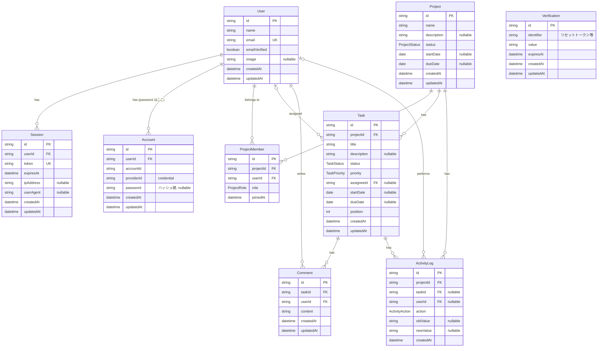

# ER 図・テーブル設計

> 認証は Better Auth（[design.md](./design.md) 2.2）。実装は [`prisma/schema.prisma`](../prisma/schema.prisma) と `prisma/migrations/`。
> 物理テーブル名は複数形のスネークケース（`users`, `project_members` など。`@@map` で指定）、カラム名はモデルのフィールド名と同じ。
> 図では省略しているが、レート制限用の `RateLimit`（`rate_limits`: key / count / lastRequest）も Better Auth が使用する。

## ER 図

## Enum

| Enum | 値 | 表示名 |
|---|---|---|
| ProjectStatus | `PLANNING` / `IN_PROGRESS` / `COMPLETED` / `ON_HOLD` | 計画中 / 進行中 / 完了 / 保留 |
| ProjectRole | `OWNER` / `MEMBER` | Owner / Member |
| TaskStatus | `TODO` / `IN_PROGRESS` / `DONE` | 未着手 / 進行中 / 完了 |
| TaskPriority | `LOW` / `MEDIUM` / `HIGH` / `URGENT` | Low / Medium / High / Urgent（デフォルト MEDIUM） |
| ActivityAction | `TASK_CREATED` / `STATUS_CHANGED` / `ASSIGNEE_CHANGED` / `DUE_DATE_CHANGED` / `PRIORITY_CHANGED` | — |

## 要件定義書からの変更点

| 変更 | 理由 |
|---|---|
| `Projects.ownerId` を廃止 | Owner は `ProjectMember.role = OWNER` で表現。二重管理による不整合を防ぐ |
| `Users.passwordHash` → `Account.password` | Better Auth の標準構造。ユーザー情報と認証情報を分離 |
| `Session` / `Account` / `Verification` / `RateLimit` を追加 | Better Auth が使用（DB セッション、パスワード再設定トークン、レート制限） |
| 開始日・期限を `DATE` 型に | 時刻を持たない値として扱い、タイムゾーンによる日付ずれを防ぐ |
| `ActivityAction` に `TASK_CREATED` を追加 | 履歴の起点として表示するため（要件の 4 種に加えて 1 種のみ） |

## 制約・インデックス・削除時の動作

| テーブル | 外部キー | onDelete | 理由 |
|---|---|---|---|
| Session / Account | userId → User | Cascade | ユーザー削除時に認証情報も削除 |
| ProjectMember | projectId → Project | Cascade | プロジェクト削除時にメンバーシップも削除 |
| ProjectMember | userId → User | Cascade | — |
| Task | projectId → Project | Cascade | プロジェクト削除時にタスクも削除 |
| Task | assigneeId → User | SetNull | ユーザーが消えてもタスクは残す |
| Comment | taskId → Task | Cascade | — |
| Comment | userId → User | Cascade | — |
| ActivityLog | projectId → Project | Cascade | — |
| ActivityLog | taskId → Task | Cascade | 履歴はタスク詳細で表示するため、タスクと共に削除 |
| ActivityLog | userId → User | SetNull | 操作者が消えても履歴は残す（「削除されたユーザー」と表示） |

| テーブル | ユニーク制約 / インデックス | 用途 |
|---|---|---|
| User | `UNIQUE(email)` | ログイン |
| ProjectMember | `UNIQUE(projectId, userId)` | 重複所属の防止、認可チェック |
| ProjectMember | `INDEX(userId)` | 「自分のプロジェクト一覧」 |
| Project | `INDEX(status)`, `INDEX(dueDate)` | 絞り込み・並べ替え |
| Task | `INDEX(projectId, status, position)` | カンバンの列ごとの取得・並び順 |
| Task | `INDEX(assigneeId)` | 担当タスク |
| Task | `INDEX(dueDate)` | 期限切れ・直近タスク |
| Comment | `INDEX(taskId, createdAt)` | タスク詳細のコメント一覧 |
| ActivityLog | `INDEX(taskId, createdAt)` | タスク詳細の履歴 |
| ActivityLog | `INDEX(projectId, createdAt)` | プロジェクト単位の履歴 |

## Owner の整合性（DB トリガー）

「すべてのプロジェクトに OWNER がちょうど 1 人存在する」を、アプリのトランザクションに加えて DB でも保証する
（マイグレーション `20261030123306_project_owner_invariant`）。

- `projects` の INSERT と `project_members` の INSERT / UPDATE / DELETE に `DEFERRABLE INITIALLY DEFERRED` の制約トリガーを設定
- 検査はトランザクションの**コミット時**に行うため、「プロジェクト作成 → OWNER 登録」を 1 トランザクション内で順に実行できる
- OWNER なしのプロジェクト作成、OWNER の 2 人目の追加、唯一の OWNER の削除・降格は、コミット時にエラーになりロールバックされる
- プロジェクト削除（CASCADE でメンバーも削除）はプロジェクト自体が存在しないため検査対象外
- 統合テスト `tests/integration/projects.test.ts`「Owner の整合性（DB トリガー）」で検証

## アプリ側で保証する制約（DB 制約では表現しにくいもの）

- プロジェクト作成と OWNER 登録は同一トランザクション（`createProject`）
- `Task.assigneeId` はそのプロジェクトのメンバーであること（`assertAssigneeIsMember`）
- メンバー削除時、そのメンバーの担当タスクの `assigneeId` を null に戻す（同一トランザクション）
- `Task.position` は (projectId, status) 内で 0 始まりの連番（移動時にトランザクションで詰め直す）
- `startDate <= dueDate`（Zod で検証）
